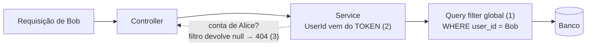

# M2a — Contas e categorias (backend)

[← Diário](README.md) · **Requisitos:** [RF-02](../prd/modulos/02-contas.md), [RF-03](../prd/modulos/03-categorias.md) · **Especificação:** [TRD contas](../trd/modulos/02-contas.md), [TRD categorias](../trd/modulos/03-categorias.md), [TRD segurança](../trd/04-seguranca.md#isolamento-entre-usuários)

**Objetivo do marco:** os primeiros dados que **pertencem** a um usuário (contas e categorias), com a garantia de que ninguém vê nem mexe nos dados de outra pessoa.

---

## 1. Isolamento entre usuários: as três camadas



1. **Query filter global**: no `AppDbContext`, toda entidade `IUserOwned` recebe `e.UserId == CurrentUserId`. Toda consulta ganha esse `WHERE` sozinha, inclusive a busca por id.
2. **Gravação**: o dono de uma conta nova é sempre `currentUser.UserId` (vem do JWT). Os DTOs **não têm** campo `userId`, então não dá para "mandar" outro dono no JSON.
3. **404, nunca 403**: buscar a conta de outra pessoa dá `null` (o filtro esconde), e a API responde "não encontrada". Ninguém descobre se um id existe testando ids alheios.

### Como o filtro funciona por dentro
```csharp
private Guid CurrentUserId => currentUser.IsAuthenticated ? currentUser.UserId : Guid.Empty;

// para cada entidade IUserOwned, monta (e) => e.UserId == this.CurrentUserId
modelBuilder.Entity(type).HasQueryFilter(filter);
```
- O EF Core monta o **modelo** uma vez só, mas lê `CurrentUserId` **a cada consulta**, como um parâmetro do SQL. Por isso cada requisição filtra pelo seu próprio usuário.
- Sem usuário logado → `Guid.Empty` → nenhuma linha. O padrão é **não mostrar nada**.
- Montamos a expressão com `System.Linq.Expressions` para aplicar o filtro a **todas** as entidades `IUserOwned` num laço. Uma entidade nova (transações no M3) só precisa implementar a interface.

### Provando que o teste protege de verdade
Um teste que passa só prova algo se ele **falharia** quando o código estivesse errado. Fizemos a prova: comentamos a linha que aplica o filtro e rodamos os testes de isolamento. **Os 3 falharam** (Bob passou a ver e alterar os dados de Alice). Restauramos o código e eles voltaram a passar. Isso é a ideia do *mutation testing*, feita à mão.

## 2. Outros conceitos

### Nomes únicos sem diferenciar maiúsculas
- "Nubank", " nubank " e "NUBANK" devem ser o mesmo nome.
- Guardamos `NormalizedName` (sem espaços nas pontas, em maiúsculas), com **índice único** `(user_id, normalized_name)` no banco.
- Duas camadas: o service checa antes (mensagem amigável, 409), e o índice do banco garante no caso raro de duas requisições simultâneas. Essa violação (`23505` no Postgres) também vira 409 no `GlobalExceptionHandler`.

### Interfaces de "marcação"
- `IUserOwned` e `IAuditable` quase não têm código, mas mudam o comportamento do sistema: uma liga o filtro de usuário, a outra liga o preenchimento automático de `CreatedAt`/`UpdatedAt` no `SaveChangesAsync`.

### `IAppDbContext` (ADR-001)
- Os services da Application dependem de uma **interface** com os `DbSet`, e não do `AppDbContext` concreto, que está na Infrastructure.
- Na injeção de dependência, a interface aponta para a **mesma instância** do `AppDbContext` da requisição.

### Transação de banco no cadastro
- Cadastrar = criar usuário + 13 categorias padrão + refresh token. Tudo dentro de `BeginTransactionAsync` / `CommitAsync`: se algo falhar no meio, nada é gravado.

### Regras que só fazem sentido no Domain
- `Category.Update(name, color, icon)` **não tem** parâmetro de tipo. O código simplesmente não permite mudar o tipo de uma categoria, sem precisar de um `if`.
- O DTO de edição (`UpdateCategoryRequest`) também não tem `type`.

### Lista fechada de ícones e formato de cor
- `AppearanceRules.AllowedIcons` aceita só nomes conhecidos do Material Symbols, e a cor precisa ser `#RRGGBB`. Isso impede que textos arbitrários sejam gravados e depois exibidos na tela.
- Um teste unitário garante que os ícones das **categorias padrão** estão nessa lista. Sem ele, um usuário novo poderia receber uma categoria que não consegue editar.

### Dinheiro com 2 casas (ADR-012)
- `numeric(18,2)` no banco e `PrecisionScale(18, 2)` no validator: `10,005` é recusado com mensagem clara.

### Erros antes da validação
- Se o JSON nem consegue ser convertido (`"type": "Bitcoin"`), o erro acontece **antes** do FluentValidation. O padrão do ASP.NET respondia em inglês e expunha o nome interno da classe. Isso foi pego no **teste manual** pelo Docker, e corrigido com `InvalidRequestResponseFactory`, que agora tem teste automatizado.

## 3. Testes

| Tipo | Quantidade | Destaques |
|------|-----------|-----------|
| Unitários | 42 | Entidades, categorias padrão (nomes únicos, ícones permitidos), validator de conta (2 casas decimais, cor, ícone) |
| Integração | 41 | CRUD de contas e categorias, nomes duplicados, arquivamento, **isolamento entre usuários** (teste obrigatório 1), JSON inválido em português |

---

## 🏋️ Exercícios sugeridos

1. **Veja o filtro no SQL:** rode a API com `dotnet watch` (modo Development mostra os comandos SQL no log), chame `GET /api/accounts` pelo Swagger e encontre no log o `WHERE a.user_id = @...`. Você não escreveu esse `WHERE` em lugar nenhum.
2. **Faça a sabotagem você mesmo:** comente a linha `ApplyUserOwnershipFilters(modelBuilder);` no `AppDbContext`, rode `dotnet test --filter UserIsolationTests` e leia as mensagens de falha. **Desfaça depois.**
3. **Teste pelo Swagger com dois usuários:** cadastre dois usuários, crie uma conta com o primeiro e tente `GET /api/accounts/{id}` com o token do segundo.
4. **Nova regra:** impeça arquivar a última conta ativa do usuário (deve sobrar pelo menos uma). Escreva primeiro o teste de integração esperando `422`, depois implemente no `AccountService` usando `BusinessRuleException`.
5. **Pergunta para pensar:** por que `RefreshToken` tem `UserId`, mas **não** implementa `IUserOwned`? (Dica: quem está logado quando o `/refresh` é chamado?)
